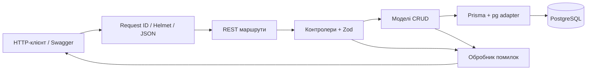
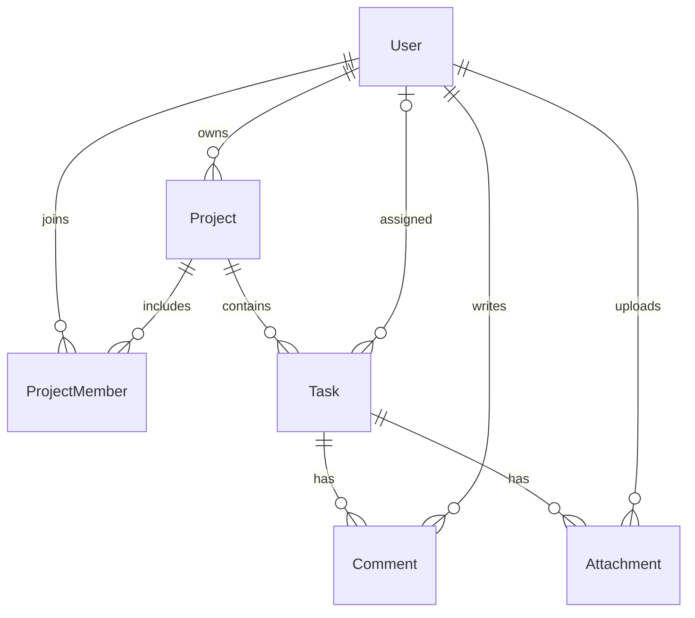

# Архітектура

Це поділ MVC для JSON API: Model — Prisma-схема й модулі `src/models`, Controller — `src/controllers`, представлення — JSON і Swagger, окремих HTML-шаблонів немає. `app.js` конструює застосунок з переданим клієнтом БД; `server.js` відповідає за процес і порт. Це дозволяє перевіряти ті самі HTTP-маршрути без запуску окремого робочого сервера.

## Сутності

`ProjectMember` — явна таблиця M:N між User і Project із роллю в межах проєкту. Складений первинний ключ не допускає повторного учасника. User.email має UNIQUE. Усі зв’язки — справжні зовнішні ключі PostgreSQL, а не лише перевірки у JavaScript. Для зовнішніх ключів, пошуку завдань за проєктом і статусом створено індекси.

Загальні CRUD-операції винесено у фабрику моделей та контролерів. Конфігурації ресурсів визначають лише дозволені поля, фільтри та Prisma delegate; довільний шлях чи назва таблиці від користувача не перетворюється на SQL. Для складеного ключа учасників є окремі модель і контролер.

Список і його кількість читаються в транзакції `RepeatableRead`, щоб метадані відповідали одному стану БД. Seed використовує транзакцію та upsert, тому повторний запуск не дублює записи. Одна атомарна операція Prisma створює, оновлює або видаляє окремий ресурс; каскади забезпечує БД.

## Можливості розвитку

Наступні лабораторні можуть додати облікові записи з хешами паролів, токени сесій і перевірку ProjectRole, WebSocket-події зміни статусу, multipart upload зі сховищем файлів та frontend. Поточні сутності вже підтримують ці напрямки, але ця робота реалізує саме CRUD backend за завданням лабораторної 1.
