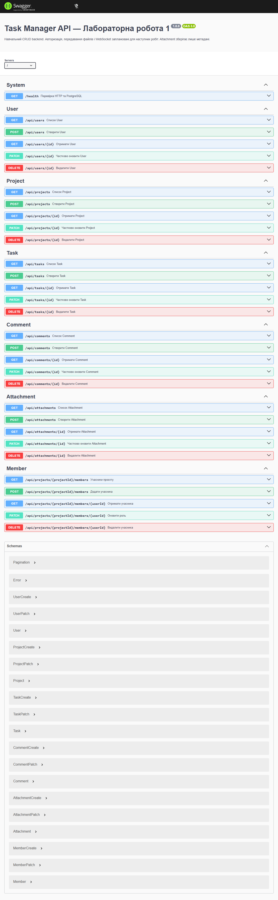
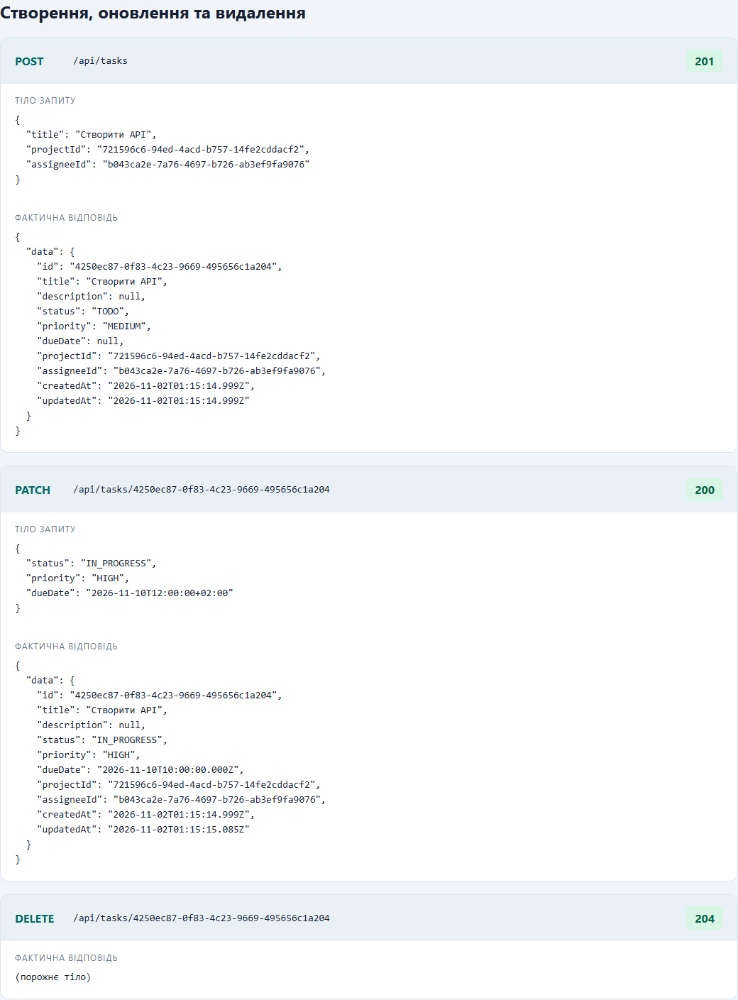
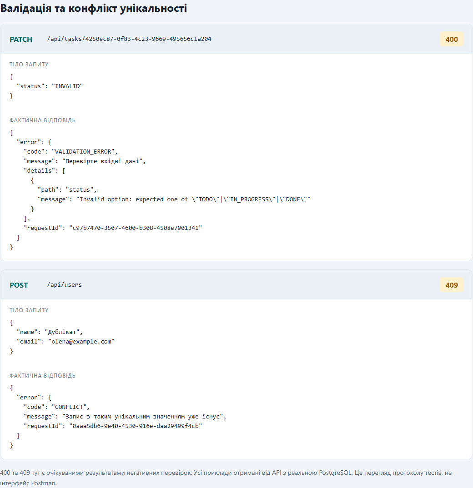

# Звіт з лабораторної роботи 1

## Тема роботи: Розроблення backend архітектури та основного функціоналу

Здобувач освіти: **[Синюк Олексій]**  
Група: **[ІПЗ-41]**  
GitHub репозиторій: **[]**

Предметна область: система управління завданнями **Task Manager**.

Мета: здобути навички розроблення серверної частини на Node.js та Express, спроєктувати реляційну БД PostgreSQL, реалізувати CRUD через Prisma, валідацію та документацію REST API.

Завдання і шаблон: [лабораторна робота 1](https://github.com/olroi421/course-web/blob/main/labs/lab-01.md), [шаблон звіту](https://github.com/olroi421/course-web/blob/main/labs/assets/lab1-report.md).

## Виконання роботи

### Налаштування проєкту

- Підготовлено окремий Node.js-проєкт із залежностями зафіксованих версій і lock-файлом.
- Використано ES modules та Express 5. Конфігурація читається з `.env`, приклад — `.env.example`.
- Винесено маршрути, контролери, моделі та допоміжні функції в окремі каталоги.
- Додано `.gitignore`, Docker Compose, інструкції запуску і запити для ручної демонстрації.
- Локальний Git ініціалізовано. Віддалений репозиторій не створювався, push не виконувався. Ім’я та email автора Git у середовищі не задані, тому коміт від імені здобувача не підроблявся; команди наведено в README.

### База даних

Спроєктовано шість таблиць:

| Модель | Призначення | Основні зв’язки |
|---|---|---|
| User | Користувач, унікальна email-адреса | Власник проєктів, виконавець, автор, учасник |
| Project | Назва, опис, власник | 1:N із Task та ProjectMember |
| ProjectMember | Участь і роль MEMBER / MANAGER | M:N User–Project через складений ключ |
| Task | Назва, статус, пріоритет, термін | Проєкт; необов’язковий виконавець; коментарі та вкладення |
| Comment | Текст коментаря | Завдання й автор |
| Attachment | Назва, MIME, розмір і URL файлу | Завдання й користувач |

У `prisma/schema.prisma` описано UUID, enum, зовнішні ключі, унікальність email та індекси. Початкова SQL-міграція зберігається в `prisma/migrations`; її застосовує `npm run db:migrate`. Демонстраційні дані створюються повторюваним `seed.js` через upsert у транзакції.

Міграція та CRUD перевіряються на справжній PostgreSQL у тимчасовому ізольованому кластері. Для звичайного запуску надано Docker Compose із PostgreSQL 17.6 або можливість використати власну БД. Модель Attachment зберігає метадані, а не вміст файлу. Файлове сховище, авторизація й WebSocket до обов’язкових операцій лабораторної 1 не належать.

Діаграма зв’язків і пояснення каскадів: [architecture.md](../docs/architecture.md), [api.md](../docs/api.md).

### Backend архітектура

1. `src/app.js` створює Express-застосунок, додає request ID, Helmet, JSON-parser, Swagger і маршрути.
2. `src/routes/api.js` зіставляє HTTP-методи з контролерами.
3. `src/controllers/` перевіряє параметри, query та JSON за схемами Zod і формує HTTP-відповіді.
4. `src/models/` виконує операції через Prisma без довільного SQL від клієнта.
5. `src/utils/errors.js` перетворює помилки в єдиний JSON-контракт.
6. `src/server.js` перевіряє конфігурацію й доступність БД до запуску HTTP та закриває з’єднання при завершенні.

Реалізовано варіант MVC для API: модель — Prisma і CRUD-модулі, контролер — HTTP-логіка, представлення — JSON. Список і `total` читаються в одній транзакції RepeatableRead. Сервер відкидає невідомі поля, порожні PATCH, некоректні UUID, enum, email, URL, дати та перевищення ліміту тіла.

### API endpoints

Для `/api/users`, `/api/projects`, `/api/tasks`, `/api/comments`, `/api/attachments` реалізовано POST і GET колекції, GET/PATCH/DELETE за UUID — разом 25 операцій. Для `/api/projects/:projectId/members` та `/:userId` реалізовано ще 5 операцій зі складеним ключем. Разом **30 CRUD-операцій**; окремо — `/health`, Swagger і OpenAPI.

Успішні коди: 200 для читання/оновлення, 201 для створення, 204 для видалення. Помилки: 400 — валідація або JSON, 404 — відсутній запис/маршрут, 409 — конфлікт унікальності чи зв’язків, 413 — розмір, 415 — тип тіла, 500 — неочікувана помилка, 503 — відмова БД. Помилки містять request ID, але не SQL чи stack trace.

Документація містить поля, фільтри, пагінацію, формати відповідей, правила видалення й приклади. OpenAPI автоматично будується зі схем валідації командою `npm run docs:build`.

## Структура проєкту

```text
lab-01-task-manager/
├── src/
│   ├── controllers/{resourceController,memberController}.js
│   ├── models/{resource,member}.js
│   ├── routes/api.js
│   ├── utils/{validation,errors,config,prisma}.js
│   ├── app.js
│   └── server.js
├── prisma/
│   ├── schema.prisma
│   ├── migrations/
│   └── seed.js
├── docs/{api.md,architecture.md,openapi.json}
├── scripts/build-openapi.js
├── tests/api.test.js
├── requests/lab-01.http
├── reports/
├── compose.yaml
├── .env.example
├── .gitignore
├── package.json
├── package-lock.json
├── prisma.config.ts
├── example-config.md
└── README.md
```

## Скріншоти тестування

Результати й фактичні HTTP-запити автоматизованої перевірки збережено в [verification.json](verification.json). Скріншоти в цій папці відображають результати цих запитів і Swagger. Це матеріали фактичного локального тестування; вони не є скріншотами Postman.

Підсумок фактичної перевірки: **15 сценаріїв пройдено, 0 помилок, 0 пропусків**. Міграцію успішно застосовано до порожньої PostgreSQL. Протокол містить 86 записаних HTTP-запитів: 24 відповіді 200, 13 — 201, 9 — 204, 14 — 400, 22 — 404, 4 — 409. Коди 4xx тут очікувані в негативних перевірках. Окремі перевірки підтверджують 413, 415 і 503.

Перевірено: CRUD усіх ресурсів і складеного ключа учасника; пагінацію й фільтри; UUID, email, enum, дати, числа та невідомі поля; дублікати й відсутні зв’язки; порожні PATCH; невідомі записи; некоректний JSON і тип тіла; захист деталей помилок; каскадне видалення та SetNull; повторний seed без дублів.

Окремо запущено саме `node src/server.js` з мігрованою й наповненою тимчасовою PostgreSQL. Перевірено `/health` і відображення 31 операції Swagger (30 CRUD та health), помилок JavaScript у браузері немає. Доказ: [startup-verification.json](startup-verification.json).

### Документація Swagger



### Створення, оновлення та видалення



### Валідація та унікальність



Зручний перегляд вибраних запитів: [test-results.html](test-results.html). Час у JSON-протоколі подано в UTC; локальне тестування виконано 1 листопада 2026 року за часом Торонто.

## Відповіді на контрольні запитання

1. **Що таке Node.js?** Середовище виконання JavaScript поза браузером на V8. Неблокувальні операції введення/виведення й event loop дозволяють обслуговувати багато мережевих запитів. Переваги — спільна мова для клієнта і сервера та екосистема npm. Тривалі CPU-обчислення слід виносити з головного потоку.
2. **Синхронні й асинхронні операції.** Синхронна операція блокує поточний потік до завершення, наприклад `readFileSync`. Асинхронна повертає керування, а результат надходить пізніше, наприклад `await prisma.task.findMany()`. `await` призупиняє конкретну async-функцію, а не весь сервер.
3. **Middleware Express.** Функція `(req, res, next)`, яка обробляє запит, завершує відповідь або передає керування через `next()`. У роботі використано Helmet, `express.json`, request ID, маршрути й фінальний обробник помилок `(error, req, res, next)`. Порядок підключення має значення.
4. **ORM і Prisma.** ORM зіставляє сутності програми з таблицями БД. Prisma надає схему, генерований клієнт, міграції, транзакції й параметризовані операції. Це зменшує повторення SQL та ризик ін’єкцій у звичайних CRUD-запитах; індекси й бізнес-правила все одно потрібно проєктувати.
5. **REST і CRUD.** Ресурси мають URL; кожен запит самодостатній, стандартні HTTP-методи визначають дію. Create — POST, Read — GET, Update — PATCH для часткового або PUT для повного заміщення, Delete — DELETE. У цьому API реалізовано PATCH.
6. **Серверна валідація.** Перевірка структури, типів, діапазонів і допустимих значень перед записом. Клієнтським перевіркам довіряти не можна. У проєкті Zod перевіряє тіло, query й UUID, а PostgreSQL додатково забезпечує зовнішні ключі та унікальність.
7. **MVC.** Model відповідає за дані, Controller — за оброблення запиту, View — за представлення. Тут Model — `src/models` та Prisma; Controller — `src/controllers`; View — JSON-відповіді. Роутер лише прив’язує URL до контролера.
8. **Міграції Prisma.** Історія змін структури БД у SQL-файлах із таблицею обліку `_prisma_migrations`. `migrate dev` створює й застосовує зміни під час розроблення, `migrate deploy` застосовує наявні міграції. `generate` оновлює клієнт і сам по собі не змінює БД.
9. **`.env`.** Набір конфігураційних значень поза вихідним кодом: URL БД, порт та режим. `dotenv` завантажує їх у `process.env`. `.env` ігнорується Git, а `.env.example` показує потрібні назви й навчальні приклади без особистих секретів.
10. **Захист API.** Основні засоби — автентифікація, перевірка дозволів, HTTPS, валідація, параметризовані запити, обмеження частоти й розміру запитів, безпечні заголовки та нерозголошення деталей помилок. Поточна робота реалізує валідацію, Prisma-запити, Helmet, ліміт JSON і JSON-помилки; автентифікація та перевірка ролей залишені для наступного етапу. Саме поле role не є перевіркою доступу.

## Висновки

Розроблено структурований backend на Express, спроєктовано реляційну модель із шістьма таблицями та зв’язками 1:N і M:N. Реалізовано CRUD через Prisma, міграцію, наповнення даними, строгі схеми валідації, пагінацію, оброблення помилок і документацію API. Підготовлено відтворюваний запуск і матеріали для демонстрації та захисту.

Самооцінка: **5 — пропонована, остаточну самооцінку підтверджує здобувач після власної перевірки**.

Обґрунтування: виконано програмні вимоги роботи, документація та тести охоплюють усі сутності, коректні операції й негативні сценарії. Для особистого подання залишаються ПІБ, група, власний GitHub-репозиторій, коміт/публікація та здавання в Moodle.
