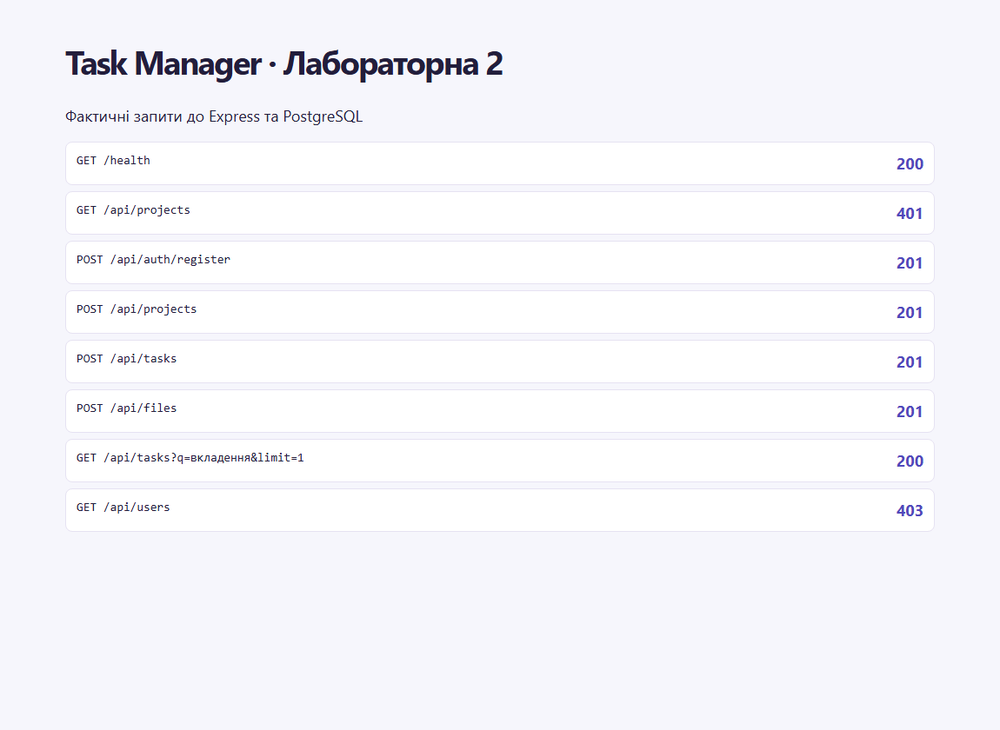
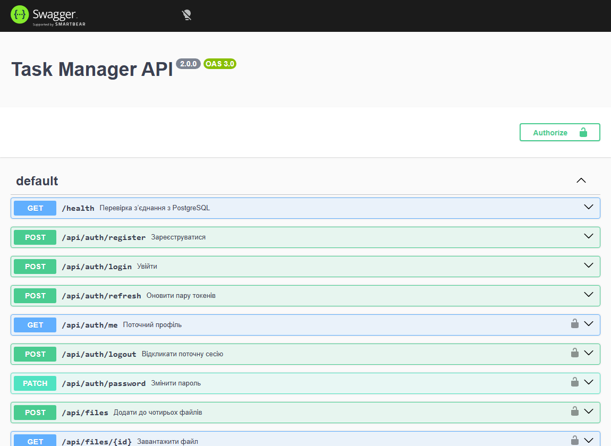

# Лабораторна робота 2 — Автентифікація, авторизація та розширений функціонал

Здобувач освіти: **Синюк Олексій**  
Група: **ІПЗ-41**  
GitHub репозиторій: [olecsix/weblabs](https://github.com/olecsix/weblabs/tree/main)

[Умова роботи](https://github.com/olroi421/course-web/blob/main/labs/lab-02.md) · [Звіт](reports/lab2-report.md)

Реєстрація, вхід, Argon2id, JWT із двома секретами, ротація refresh, вихід, зміна пароля. Захист REST, ролі USER/ADMIN і ролі проєкту. Пагінація, пошук, фільтри, файли та Swagger.

## Запуск

Потрібні Node.js 24, npm і PostgreSQL. Відкрийте термінал у папці цієї лабораторної. Скопіюйте `.env.example` у `.env` і заповніть `JWT_SECRET` та `REFRESH_TOKEN_SECRET` двома різними результатами команди нижче. За потреби замініть `DATABASE_URL` і `FRONTEND_URL`.

```bash
node -p "require('node:crypto').randomBytes(32).toString('hex')"
npm ci
docker compose up -d --wait db
npm run db:generate
npm run db:migrate
npm start
```

Для власної PostgreSQL пропустіть Compose і вкажіть рядок підключення. Для запуску на тій самій БД обирайте лише один backend одночасно. Міграції зберігають записи попередніх етапів.

- Swagger — [localhost:3000/docs/](http://localhost:3000/docs/).
- OpenAPI — [localhost:3000/openapi.json](http://localhost:3000/openapi.json).
- Перевірка БД — [localhost:3000/health](http://localhost:3000/health).

Для демо додайте свій `DEMO_PASSWORD` довжиною від 8 до 128 символів у локальний `.env` і виконайте `npm run db:seed`. Демо-акаунти — `olena@example.com` та `andrii@example.com`. Пароль обирає той, хто запускає проєкт. На хостингу реєструйте власний обліковий запис через API. Для перевірок виконайте `npm test` після генерації Prisma Client. Тести запускають окрему PostgreSQL і застосовують міграції.

## Контракт API

| Маршрут | Призначення |
|---|---|
| POST /api/auth/register | Поля name, email, password. Повертає профіль і пару токенів |
| POST /api/auth/login | Поля email, password. Повертає профіль і пару токенів |
| POST /api/auth/refresh | Поле refreshToken. Відкликає стару пару та видає нову |
| GET /api/auth/me | Профіль поточної сесії |
| PATCH /api/auth/password | currentPassword і newPassword. Відкликає сесії |
| POST /api/auth/logout | Відкликає поточну сесію |
| /api/projects, /api/tasks, /api/comments, /api/attachments | CRUD, пагінація, фільтри та пошук |
| /api/projects/:projectId/members | CRUD участі в проєкті |
| /api/users | CRUD профілів для ADMIN |
| POST /api/files | multipart, поле taskId, до 4 файлів у полі files |
| GET /api/files/:id | Отримання вмісту як вкладення |
| PATCH /api/files/:id | multipart, поле file. Заміна вмісту |
| DELETE /api/attachments/:id | Видаляє метадані та вміст |

Захищені запити потребують `Authorization: Bearer <accessToken>`. У Swagger виконайте реєстрацію, скопіюйте `tokens.accessToken` і вставте в **Authorize**. Створення проєкту приймає `name` та `description`, власник береться із сесії. Далі створіть завдання з `title` і `projectId`. Запит `GET /api/tasks?q=api&status=TODO&page=1&limit=10&sort=newest` повертає записи й `meta`.

Файловий сервіс звіряє розширення, MIME й заголовок PNG/JPEG/PDF або коректність UTF-8 для TXT. Максимум 5 МБ на файл. Вміст зберігається в PostgreSQL; записи попередньої лабораторної можуть містити зовнішні посилання. Власник або ADMIN керує учасниками. Менеджер змінює проєкт і може видаляти завдання. Учасники читають і редагують завдання, додають та змінюють власні коментарі й файли.

Типові відповіді. 400 — валідація, 401 — сесія або пароль, 403 — недостатня роль, 404 — запис поза доступом або відсутній, 409 — конфлікт записів чи паралельна зміна, 413 — завеликий запит, 415 — формат, 429 — ліміт запитів.

Реалізовано рівні 1 і 2, а також ліміти автентифікації, аудит мутацій, права на рівні проєкту, кілька файлів за запит і документацію. Відновлення через email, 2FA та соціальний OAuth з рівня 3 залишаються поза цією версією.

## Перевірка

Три інтеграційні сценарії пройшли на тимчасовій PostgreSQL. Перевірено Argon2id, 400/401/403/409, ротацію, відкликання, фільтрацію, доступ до чужого проєкту, додавання, заміну й видалення файлу. Рівні 1–2 реалізовано, частина рівня 3 описана в README.

## Скріншоти




