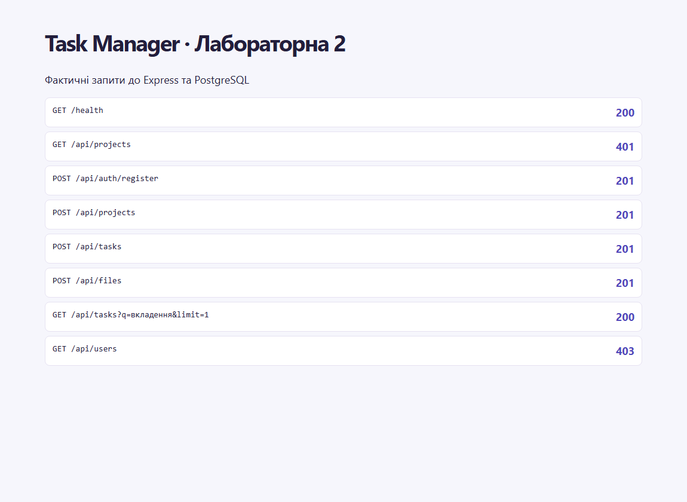
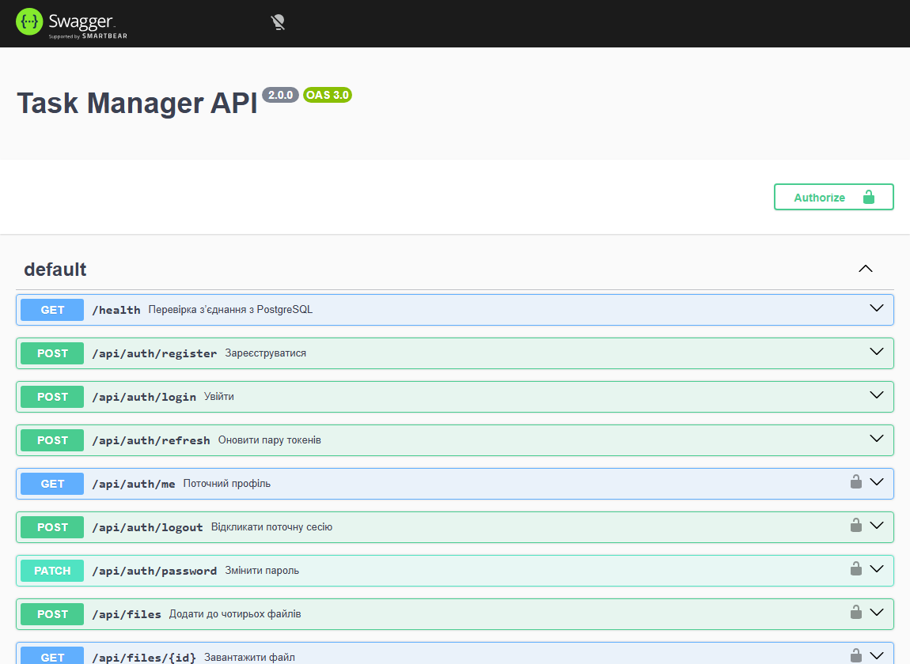

# Звіт з лабораторної роботи 2

## Тема роботи

Автентифікація, авторизація та розширений функціонал

Здобувач освіти: **Синюк Олексій**  
Група: **ІПЗ-41**  
GitHub репозиторій: [olecsix/weblabs](https://github.com/olecsix/weblabs/tree/main)
Рівень складності: **2 з окремими функціями рівня 3**  

[Умова роботи](https://github.com/olroi421/course-web/blob/main/labs/lab-02.md) · [Запуск і документація](../README.md)

## Мета

Перевірити особу користувача та контролювати доступ до проєктів і файлів.

## Реалізований функціонал

Реєстрація, вхід, Argon2id, JWT із двома секретами, ротація refresh, вихід, зміна пароля. Захист REST, ролі USER/ADMIN і ролі проєкту. Пагінація, пошук, фільтри, файли та Swagger.

## Ключові фрагменти коду

`src/utils/security.js` підписує і перевіряє токени. `src/routes/auth.js` відкликає refresh у транзакції. `src/routes/resources.js` обмежує запити видимими проєктами. `src/routes/files.js` валідує завантаження і зберігає байти в PostgreSQL.

## Перевірка

Три інтеграційні сценарії пройшли на тимчасовій PostgreSQL. Перевірено Argon2id, 400/401/403/409, ротацію, відкликання, фільтрацію, доступ до чужого проєкту, додавання, заміну й видалення файлу. Рівні 1–2 реалізовано, частина рівня 3 описана в README.

## Скріншоти

## Контрольні запитання

1. Автентифікація встановлює особу через пароль або JWT. Авторизація перевіряє, чи має ця особа доступ до конкретного проєкту.
2. JWT складається із заголовка, payload і підпису. Підпис дозволяє перевірити цілісність і походження токена. Вміст payload доступний для читання.
3. Argon2id потребує пам’яті й часу для кожної перевірки. Унікальна випадкова сіль заважає повторному використанню попередньо обчислених хешів.
4. Middleware Express перевіряє Bearer-токен та активну сесію, додає профіль у req і передає керування через next().
5. RBAC зіставляє ролі з правами. ADMIN керує користувачами, а доступ до ресурсів визначається власником і роллю учасника проєкту.
6. Multer розбирає multipart і обмежує кількість та розмір файлів. Код звіряє розширення, MIME і вміст.
7. page і limit задають skip/take. Сервер повертає total і totalPages зі стабільним сортуванням.
8. Swagger UI читає OpenAPI і дає спробувати запити. Схеми запитів CRUD беруться з тих самих схем Zod.
9. Витокам паролів протидіють Argon2id і приховані поля. Неконтрольований доступ обмежено ролями та областю проєкту. Ліміти, CORS і валідація зменшують зловживання.
10. Access живе 15 хвилин і використовується в REST. Refresh живе 7 днів і замінюється при оновленні. Старий refresh і пов’язаний access відкликаються.

## Висновки

Три інтеграційні сценарії пройшли на тимчасовій PostgreSQL.
