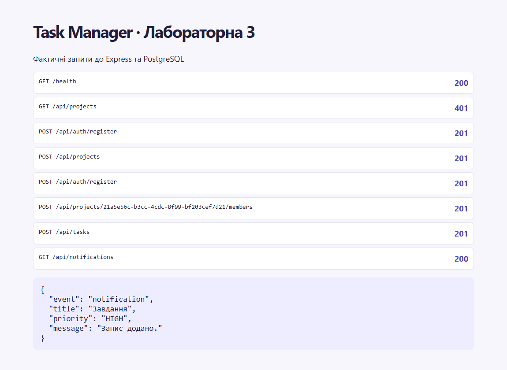

# Лабораторна робота 3 — Взаємодія в реальному часі та фіналізація серверної частини

Здобувач освіти: **Синюк Олексій**  
Група: **ІПЗ-41**  
GitHub репозиторій: [olecsix/weblabs](https://github.com/olecsix/weblabs/tree/main)

[Умова роботи](https://github.com/olroi421/course-web/blob/main/labs/lab-03.md) · [Звіт](reports/lab3-report.md)

JWT-підключення, кімнати користувачів і сесій, сповіщення, присутність, відновлення через REST, метрики, опційний Redis та BullMQ.

## Запуск

Потрібні Node.js 24, npm і PostgreSQL. Відкрийте термінал у папці цієї лабораторної. Скопіюйте `.env.example` у `.env` і заповніть `JWT_SECRET` та `REFRESH_TOKEN_SECRET` двома різними результатами команди нижче. За потреби замініть `DATABASE_URL` і `FRONTEND_URL`.

```bash
node -p "require('node:crypto').randomBytes(32).toString('hex')"
npm ci
docker compose up -d --wait db
npm run db:generate
npm run db:migrate
npm start
```

Для власної PostgreSQL пропустіть Compose і вкажіть рядок підключення. Для запуску на тій самій БД обирайте лише один backend одночасно. Міграції зберігають записи попередніх етапів.

- Swagger — [localhost:3000/docs/](http://localhost:3000/docs/).
- OpenAPI — [localhost:3000/openapi.json](http://localhost:3000/openapi.json).
- Перевірка БД — [localhost:3000/health](http://localhost:3000/health).

Для демо додайте свій `DEMO_PASSWORD` довжиною від 8 до 128 символів у локальний `.env` і виконайте `npm run db:seed`. Демо-акаунти — `olena@example.com` та `andrii@example.com`. Пароль обирає той, хто запускає проєкт. На хостингу реєструйте власний обліковий запис через API. Для перевірок виконайте `npm test` після генерації Prisma Client. Тести запускають окрему PostgreSQL і застосовують міграції.

Для перевірки індексів виконайте `npm run benchmark`. Скрипт створює тимчасову БД із 20 000 завдань. [Фактичний план запиту](reports/query-plan.json).

## Socket.IO

Підключайтеся до адреси сервера без `/api` із `auth.token` та `transports: ['websocket']`. Сервер перевіряє JWT і стан сесії, додає клієнта в кімнати `user:<id>` та `session:<id>`, а після спливу токена закриває з’єднання. Ліміт становить 30 вхідних подій за 10 секунд на з’єднання.

| Подія | Напрямок | Дані |
|---|---|---|
| resource:changed | сервер → клієнт | resource, action, id, projectId. Клієнт перечитує дані через REST |
| notification | сервер → користувач | id, type, priority, title, message, createdAt, readAt |
| presence:changed | сервер → клієнт | Сигнал перечитати присутність |
| presence:project | клієнт → сервер | UUID проєкту, відповідь onlineIds або error |
| session:expired | сервер → клієнт | Сигнал отримати новий access token через refresh |

`GET /api/notifications?page=1&limit=30` повертає збережені повідомлення. `PATCH /api/notifications/:id` з `{}` позначає повідомлення прочитаним. Після reconnect клієнт оновлює списки та повідомлення. `GET /api/projects/:projectId/stats` групує завдання за статусом. `PATCH /api/projects/:projectId/task-order` приймає повний масив UUID до 100 завдань від власника, менеджера або ADMIN. `GET /api/metrics` доступний ADMIN.

За наявності `REDIS_URL` сервер запускає Redis-адаптер, короткий кеш статистики та чергу BullMQ для прибирання протермінованих сесій. Для локального Redis виконайте `docker compose --profile realtime up -d --wait db redis` і задайте `REDIS_URL=redis://127.0.0.1:6379`. Після зміни завдань запис кешу видаляється. Між кількома екземплярами потрібні спільні БД, Redis і JWT-секрети. Лише WebSocket-транспорт дозволяє працювати без sticky sessions для HTTP polling. Локальні тести перевірили конфігурацію з одним екземпляром і PostgreSQL; багатовузловий Redis потребує окремого середовища.

## Розгортання на Render

1. Увійдіть у Render і дозвольте доступ до приватного `olecsix/weblabs`.
2. Створіть Blueprint із гілки `main` і вкажіть `lab 3/render.yaml` як шлях до конфігурації. Альтернатива — Web Service з Root Directory `lab 3` і командами з цього YAML.
3. Задайте `FRONTEND_URL` як origin клієнта. Для першого локального тесту підійде `http://localhost:5173`. Після публікації клієнта оновіть origin на домен Vercel.
4. Після запуску перевірте `/health`, `/docs/` і підключення Socket.IO. Скопіюйте HTTPS URL у конфігурацію клієнта.

Публічний сервіс Render ще не створений. Безкоштовний вебсервіс засинає, файлову систему може бути скинуто, а безкоштовна PostgreSQL має обмежений термін. Тому файли зберігаються в БД. Для горизонтального масштабування оберіть тариф з кількома екземплярами й налаштуйте спільний Redis. [Обмеження Render Free](https://render.com/docs/free).

## Перевірка

Шість інтеграційних сценаріїв пройшли. Перевірено ізоляцію кімнат, перепідключення, сповіщення офлайн-користувачу та збереження порядку. На 20 000 завдань план запиту змінився з Bitmap Heap Scan + Sort на Index Scan, з 102 до 22 буферних звернень у цьому запуску. Render підготовлено, публічний сервер ще не підключено.

## Скріншоти


