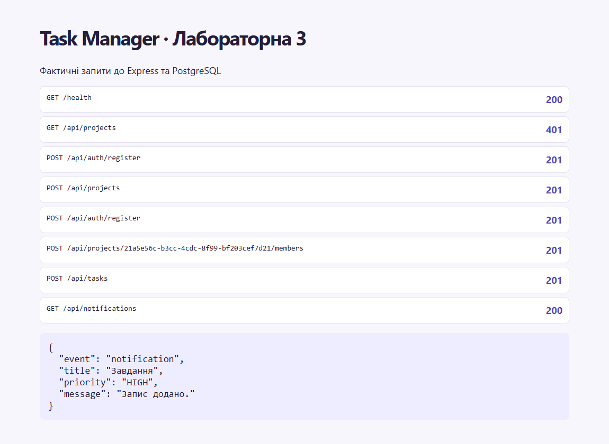

# Звіт з лабораторної роботи 3

## Тема роботи

Взаємодія в реальному часі та фіналізація серверної частини

Здобувач освіти: **Синюк Олексій**  
Група: **ІПЗ-41**  
GitHub репозиторій: [olecsix/weblabs](https://github.com/olecsix/weblabs/tree/main)

[Умова роботи](https://github.com/olroi421/course-web/blob/main/labs/lab-03.md) · [Запуск і документація](../README.md)

## Мета

Додати оновлення в реальному часі та виміряти ефект індексації.

## Реалізований функціонал

JWT-підключення, кімнати користувачів і сесій, сповіщення, присутність, відновлення через REST, метрики, опційний Redis та BullMQ.

## Ключові фрагменти коду

`src/realtime.js` авторизує Socket.IO й адресує події учасникам. `src/routes/live.js` надає історію, статистику та атомарне сортування. Міграція `20261103000000_realtime` створює індекси й Notification.

## Перевірка

Шість інтеграційних сценаріїв пройшли. Перевірено ізоляцію кімнат, перепідключення, сповіщення офлайн-користувачу та збереження порядку. На 20 000 завдань план запиту змінився з Bitmap Heap Scan + Sort на Index Scan, з 102 до 22 буферних звернень у цьому запуску. Render підготовлено, публічний сервер ще не підключено.

## Скріншоти

## Контрольні запитання

1. HTTP передає незалежні запити. WebSocket зберігає двостороннє з’єднання, тому підходить для змін, які сервер має надсилати одразу.
2. Socket.IO додає протокол подій, підтвердження, кімнати й перепідключення. Клієнт очікує узгоджений протокол Socket.IO.
3. Namespace відділяє групи обробників. Room групує сокети в одному namespace. Тут кімнати адресуються користувачу й сесії.
4. JWT проходить перевірку підпису і сесії під час handshake. Після закінчення строку сервер закриває сокет, клієнт оновлює токен.
5. Після reconnect клієнт перечитує ресурси та історію сповіщень. Тимчасові сигнали можуть бути пропущені, а поточний стан відновлюється через REST.
6. B-tree впорядковує ключі й допомагає пошуку та сортуванню. Композитний індекс відповідає projectId, createdAt і id. Індекси коштують місця й часу запису.
7. N+1 означає окремий запит для кожного рядка після списку. Учасників і їхні імена запитуємо разом через include; статистика використовує groupBy.
8. EXPLAIN ANALYZE виконує запит і показує фактичний план, час та кількість рядків. Seq Scan читає таблицю, Index Scan іде за ключами індексу.
9. Redis передає кімнатні події між процесами. Sticky sessions потрібні для повторних polling-запитів до одного процесу; тут залишено WebSocket-транспорт.
10. Free Render може засинати, диск тимчасовий, а БД має строк дії. migrate deploy застосовує готові міграції, migrate dev генерує зміни під час розробки.

## Висновки

Шість інтеграційних сценаріїв пройшли.
