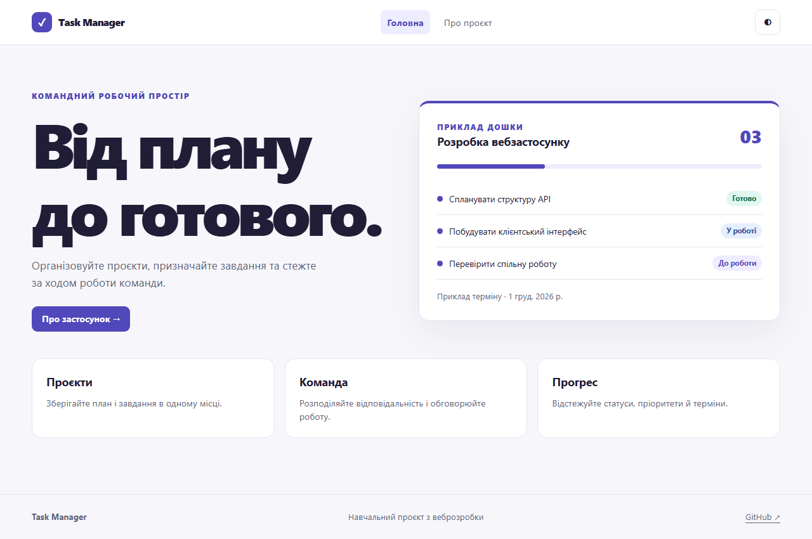
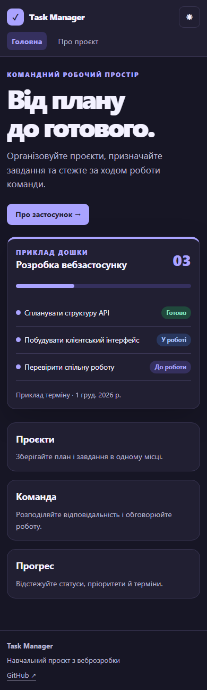

# Лабораторна робота 4 — Реалізація React-проєкту

Здобувач освіти: **Синюк Олексій**  
Група: **ІПЗ-41**  
GitHub репозиторій: [olecsix/weblabs](https://github.com/olecsix/weblabs/tree/main)

[Умова роботи](https://github.com/olroi421/course-web/blob/main/labs/lab-04.md) · [Звіт](reports/lab4-report.md)

Vite, React, TypeScript, Tailwind 4, ESLint, Prettier, React Router, Axios, типи, темна тема, Error Boundary та адаптивні компоненти.

## Запуск

Потрібні Node.js 24 і npm. Команди виконуються в папці цієї роботи.

```bash
npm ci
npm run dev
```

Відкрийте [localhost:5173](http://localhost:5173). Скопіюйте `.env.example` у `.env`, якщо адреса API відрізняється від стандартної. Для перевірки й виробничої збірки виконайте `npm run lint` і `npm run build`. `npm run preview` відкриває збірку для локальної перевірки. `npx playwright install chromium` встановлює браузер для `npm test`.

Головна, «Про проєкт» і 404 працюють локально. Сторінка «Про проєкт» викликає `GET /health` із лабораторної 3 через Axios і показує стан API. Приклад дошки на головній має демонстраційні дані. Для змінення теми скористайтеся кнопкою в заголовку.

`components/` містить макет, кнопки, поля, картки, мітки, індикатор і Error Boundary. `pages/` містить маршрути, `services/` — Axios, `types/` — контракти, `utils/` — форматування. `@/` відповідає каталогу `src/`. Темна тема зберігається в браузері; кольори й типографіка визначені у `styles.css`.

## Перевірка

Виробнича збірка і лінтинг пройшли. Playwright перевірив головну, «Про проєкт», 404, збереження теми та відсутність горизонтального прокручування на ширині 390 px.

## Скріншоти




