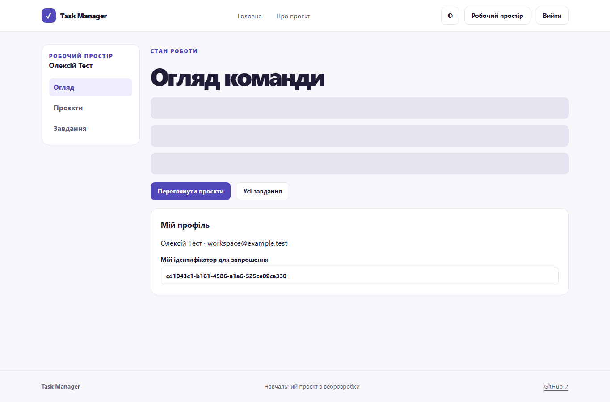
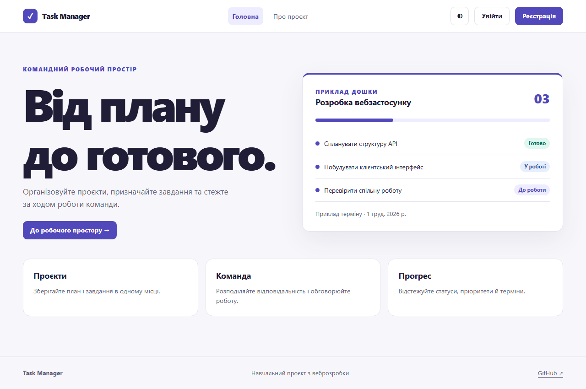
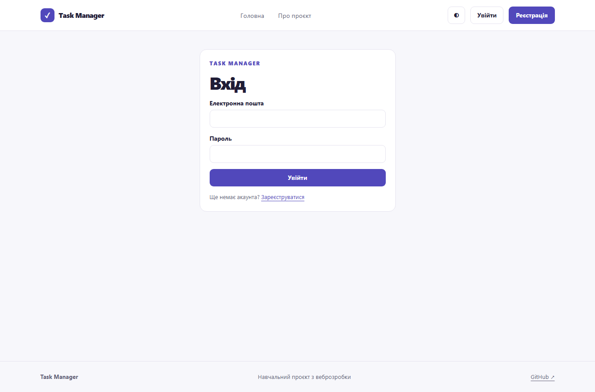
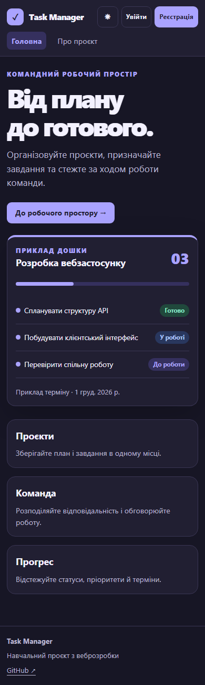
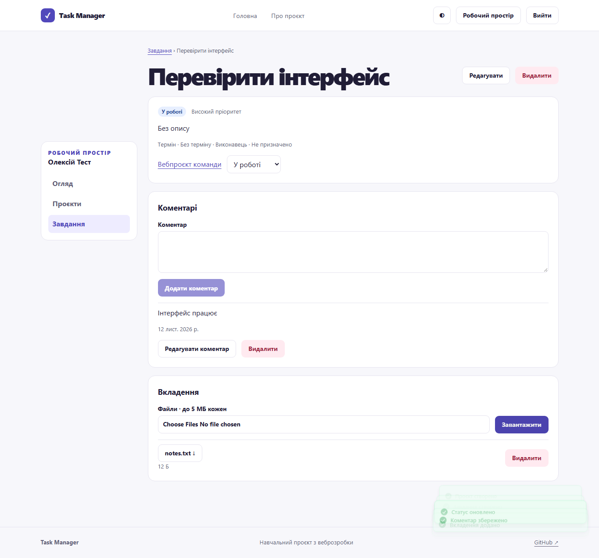
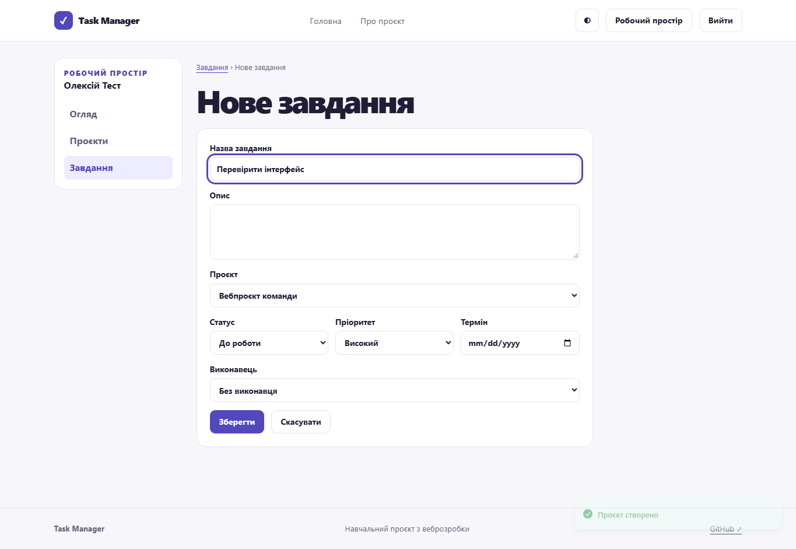
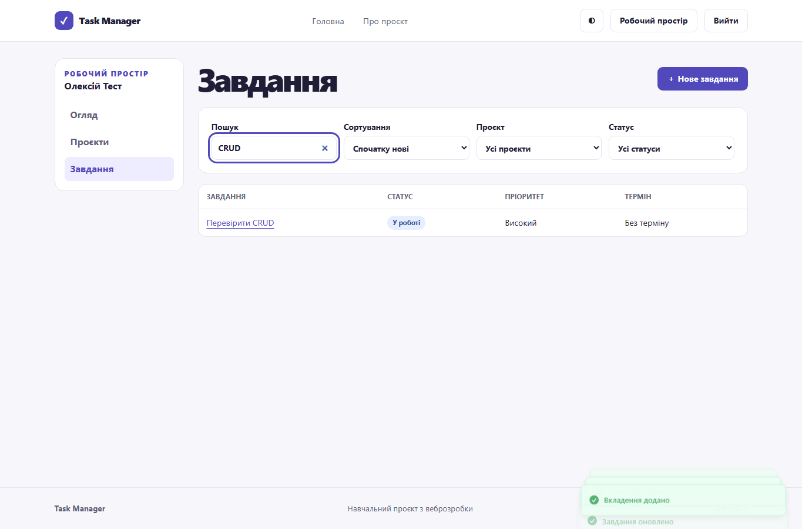

# Лабораторна робота 5 — Розроблення основного інтерфейсу та функціоналу

Здобувач освіти: **Синюк Олексій**  
Група: **ІПЗ-41**  
GitHub репозиторій: [olecsix/weblabs](https://github.com/olecsix/weblabs/tree/main)

[Умова роботи](https://github.com/olroi421/course-web/blob/main/labs/lab-05.md) · [Звіт](reports/lab5-report.md)

Форми входу та реєстрації, захищені маршрути, сесія, огляд, списки й редагування проєктів і завдань, учасники, коментарі та вкладення. Пошук, фільтри, сортування, пагінація, toast і skeleton.

## Запуск

Потрібні Node.js 24 і npm. Команди виконуються в папці цієї роботи.

```bash
npm ci
npm run dev
```

Відкрийте [localhost:5173](http://localhost:5173). Скопіюйте `.env.example` у `.env`, якщо адреса API відрізняється від стандартної. Для перевірки й виробничої збірки виконайте `npm run lint` і `npm run build`. `npm run preview` відкриває збірку для локальної перевірки. `npx playwright install chromium` встановлює браузер для `npm test`.

Запустіть сервер із [lab 3](../lab%203/README.md) із `FRONTEND_URL=http://localhost:5173`. Зареєструйтеся, створіть проєкт і завдання. Ідентифікатор для запрошення видно в профілі на сторінці огляду. Запросіть інший зареєстрований акаунт через форму учасників проєкту.

Для наскрізного тесту встановіть залежності в обох папках і згенеруйте Prisma Client у `lab 3`. Команда `npm run test:e2e` запускає ізольовані сервер і PostgreSQL та перевіряє браузерний сценарій. Для цього порт 5179 має бути вільним.

## Як перевірити

1. Відкрийте `/tasks` без входу. З’явиться форма входу.
2. Зареєструйтесь і створіть проєкт. Додайте завдання з пріоритетом і терміном, змініть статус.
3. Додайте коментар та вкладення, відкрийте список завдань, застосуйте пошук і фільтр.
4. Відредагуйте запис і видаліть його через підтвердження. Вийдіть із системи.

React Hook Form і Zod перевіряють форми. Zustand зберігає пару токенів у `sessionStorage` поточної вкладки. Axios додає JWT і виконує одну спільну ротацію при одночасних 401. TanStack Query керує даними й скидає кеш при зміні користувача. Маршрути захищено на клієнті, а доступ до записів повторно перевіряє API.

## Перевірка

Пройшли дві браузерні перевірки з реальним API і тимчасовою PostgreSQL. Наскрізний сценарій перевірив захищений маршрут, реєстрацію, створення, зміну статусу, коментар, файл, редагування, пошук, видалення і вихід.

## Скріншоти














