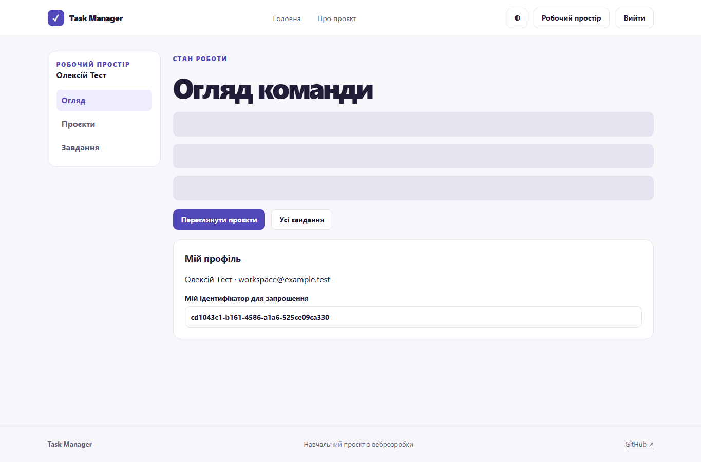
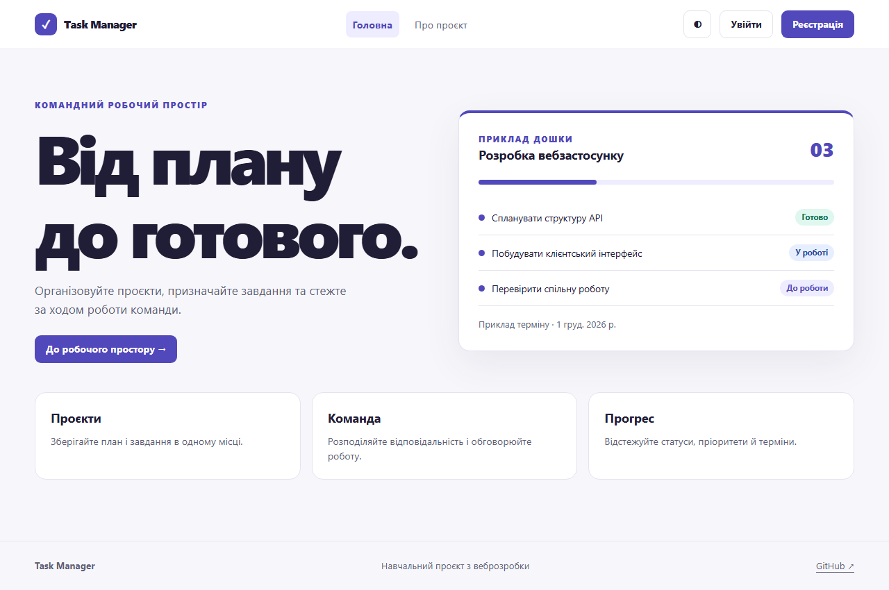
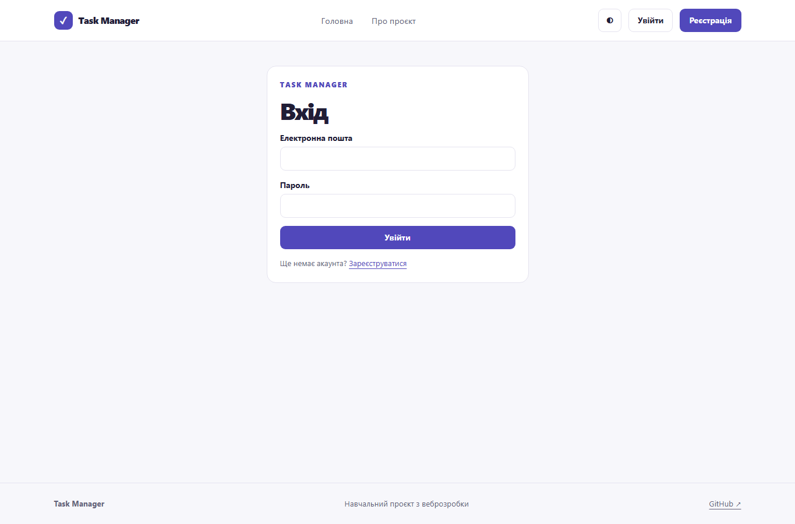
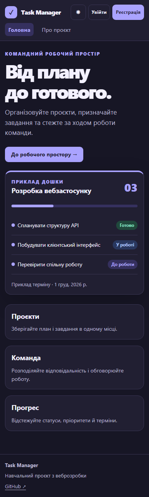
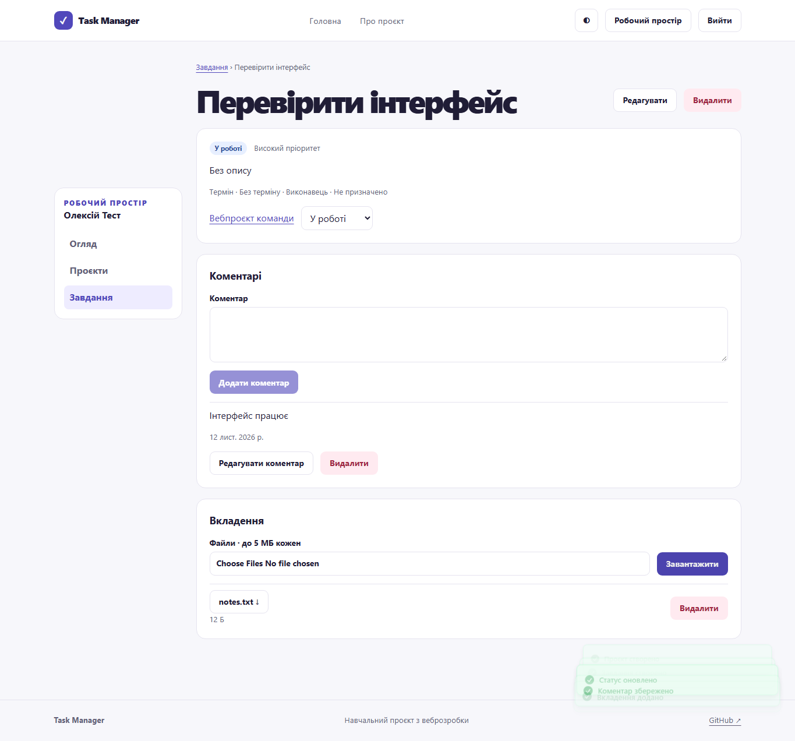
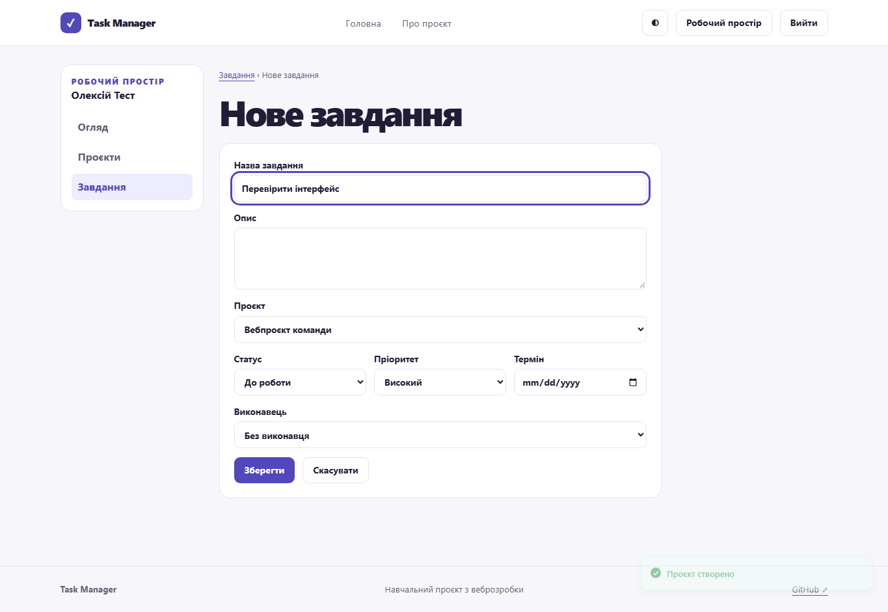
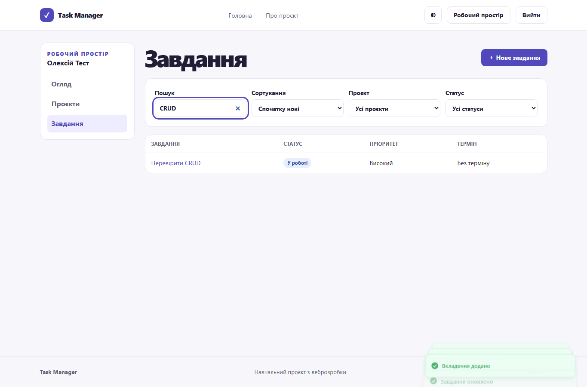

# Звіт з лабораторної роботи 5

## Тема роботи

Розроблення основного інтерфейсу та функціоналу

Здобувач освіти: **Синюк Олексій**  
Група: **ІПЗ-41**  
GitHub репозиторій: [olecsix/weblabs](https://github.com/olecsix/weblabs/tree/main)

[Умова роботи](https://github.com/olroi421/course-web/blob/main/labs/lab-05.md) · [Запуск і документація](../README.md)

## Мета

Реалізувати робочий інтерфейс для взаємодії з REST API.

## Реалізований функціонал

Форми входу та реєстрації, захищені маршрути, сесія, огляд, списки й редагування проєктів і завдань, учасники, коментарі та вкладення. Пошук, фільтри, сортування, пагінація, toast і skeleton.

## Ключові фрагменти коду

`src/stores/auth.ts` керує сесією. `src/services/data.ts` містить TanStack Query і методи CRUD. `src/pages/Editor.tsx` перевіряє форми через React Hook Form та Zod.

## Перевірка

Пройшли дві браузерні перевірки з реальним API і тимчасовою PostgreSQL. Наскрізний сценарій перевірив захищений маршрут, реєстрацію, створення, зміну статусу, коментар, файл, редагування, пошук, видалення і вихід.

## Скріншоти

## Контрольні запитання

1. Контрольований input отримує value зі стану. React Hook Form переважно використовує refs і підписки, тому зміна поля не змушує всю форму перемальовуватись.
2. API перевіряє Bearer JWT і сесію. Тут токени живуть у sessionStorage вкладки. JS-сховище доступне при XSS; альтернатива для refresh — HttpOnly cookie з відповідним захистом CSRF.
3. Zod перевіряє структуру і виводить типи. z.input описує вхід, z.output — результат після перетворень. preprocess може перетворити порожній рядок у undefined.
4. ProtectedRoute повертає Outlet лише для наявної сесії. Сервер перевіряє права незалежно від маршруту в браузері.
5. Context підходить для спільного контексту, Zustand надає вибіркові підписки. TanStack Query відповідає за кеш, повтори та оновлення серверних даних.
6. queryKey ідентифікує кеш за ресурсом та фільтрами. invalidateQueries позначає його застарілим і повторює активні запити.
7. Оптимістичне оновлення показує очікуваний результат до відповіді сервера. При помилці потрібне відновлення збереженого стану.
8. Axios формує єдину API-помилку, форми показують поля та root error, toast повідомляє про мутації. Error Boundary обробляє помилки рендера.
9. Debounce відкладає запит до паузи у введенні, зменшуючи мережеве навантаження й миготіння списку.
10. Skeleton зберігає приблизну геометрію майбутніх записів і зменшує стрибки макета під час завантаження.

## Висновки

Пройшли дві браузерні перевірки з реальним API і тимчасовою PostgreSQL.
