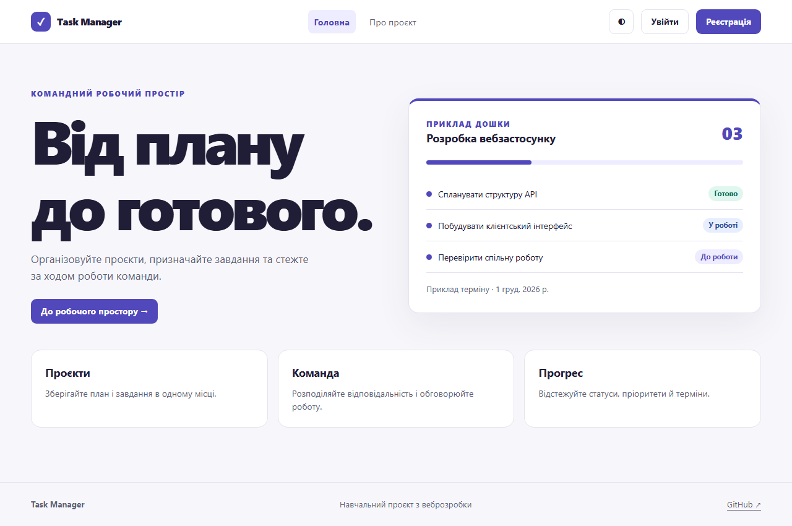
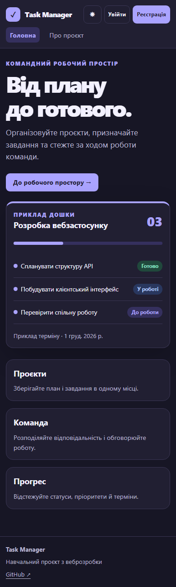
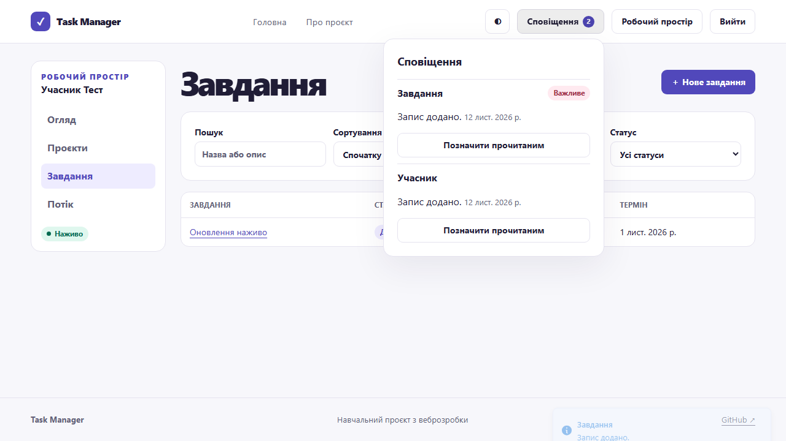
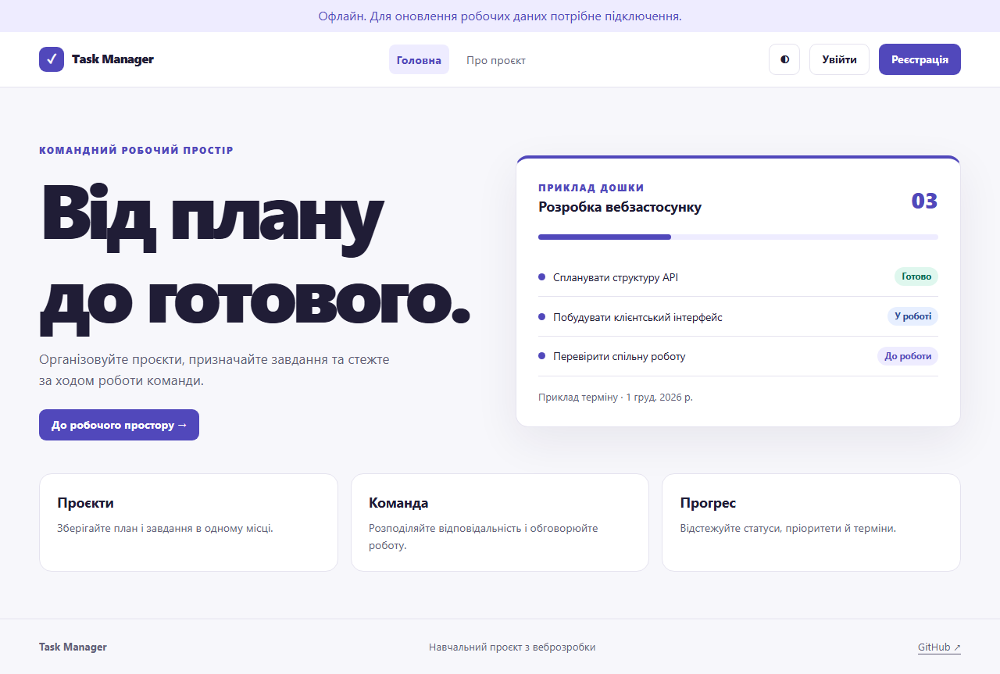

# Лабораторна робота 6 — Розширені можливості та розгортання клієнтської частини

Здобувач освіти: **Синюк Олексій**  
Група: **ІПЗ-41**  
GitHub репозиторій: [olecsix/weblabs](https://github.com/olecsix/weblabs/tree/main)

[Умова роботи](https://github.com/olroi421/course-web/blob/main/labs/lab-06.md) · [Звіт](reports/lab6-report.md)

Сповіщення, присутність, оновлення списків, діалоги, таби, пошукове меню, DnD, статистика, нескінченний список, crop, календар, форматування та анімації. PWA, lazy-маршрути, SEO, Vercel і CI.

## Запуск

Потрібні Node.js 24 і npm. Команди виконуються в папці цієї роботи.

```bash
npm ci
npm run dev
```

Відкрийте [localhost:5173](http://localhost:5173). Скопіюйте `.env.example` у `.env`, якщо адреса API відрізняється від стандартної. Для перевірки й виробничої збірки виконайте `npm run lint` і `npm run build`. `npm run preview` відкриває збірку для локальної перевірки. `npx playwright install chromium` встановлює браузер для `npm test`.

Запустіть сервер із [lab 3](../lab%203/README.md) із `FRONTEND_URL=http://localhost:5173`. Зареєструйтеся, створіть проєкт і завдання. Ідентифікатор для запрошення видно в профілі на сторінці огляду. Запросіть інший зареєстрований акаунт через форму учасників проєкту.

Для наскрізного тесту встановіть залежності в обох папках і згенеруйте Prisma Client у `lab 3`. Команда `npm run test:e2e` запускає ізольовані сервер і PostgreSQL та перевіряє браузерний сценарій. Для цього порт 5179 має бути вільним.

Для перевірки PWA встановіть змінну `LAB_PRODUCTION=1` перед `npm run test:e2e` (PowerShell: `$env:LAB_PRODUCTION = '1'`). Сценарій збирає клієнт, перевіряє офлайн-перезавантаження і синхронізацію у двох браузерних сесіях.

## Можливості

- Socket.IO підтримує присутність учасників, сповіщення й оновлення кешу. Після відновлення з’єднання клієнт перечитує історію сповіщень і актуальні списки.
- У проєкті є таби «Статистика» та «Порядок завдань». Менеджер може змінити порядок до 100 завдань мишею або клавіатурою. Порядок зберігається на сервері.
- Потік завдань має пошук, меню вибору проєкту й підвантаження при прокручуванні. Для доступності є кнопка «Показати ще».
- Завдання має календар, форматований опис із жирним текстом і курсивом, попередній перегляд та квадратне обрізання PNG/JPEG. Підтвердження видалення відкривається в діалозі.
- React.lazy розділяє збірку за сторінками. Service Worker кешує оболонку та статичні ресурси. Приватні відповіді API не зберігаються в PWA-кеші.

## Розгортання на Vercel

1. Після запуску сервера на Render імпортуйте `olecsix/weblabs` у Vercel. Вкажіть Root Directory `lab 6`, Framework Vite і Node.js 24.
2. Додайте `VITE_API_URL=https://<backend>/api` та `VITE_SOCKET_URL=https://<backend>`. Ці адреси потрапляють у збірку. Перезапустіть збірку після зміни значень.
3. Задайте origin клієнта у `FRONTEND_URL` на Render. Перевірте прямі переходи `/login` та `/projects`, а потім WebSocket. SPA rewrite вже описано у `vercel.json`.
4. Для публікації через GitHub Actions підключіть production environment із `VERCEL_TOKEN`, `VERCEL_ORG_ID` та `VERCEL_PROJECT_ID`. Якщо керуєте публікацією через Actions, вимкніть дубльоване автоматичне розгортання з Git у Vercel. Публікація запускається тільки після тестів на `main`.

Публічний URL клієнта ще не створений. Верифіковано локальну виробничу збірку і взаємодію з реальним API. [Документація Vercel для кількох проєктів в одному репозиторії](https://vercel.com/docs/monorepos).

## Перевірка

Пройшли чотири браузерні перевірки виробничої збірки. Дві окремі сесії синхронізували завдання і сповіщення, а офлайн-тест перезавантажив кешовану оболонку. Vercel підготовлено, публічний сайт ще не підключено.

## Скріншоти








