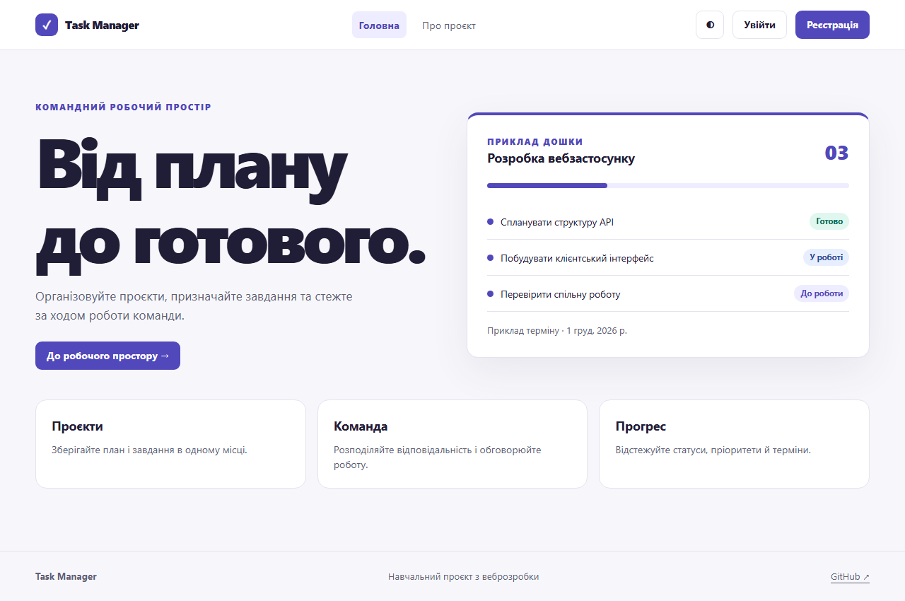
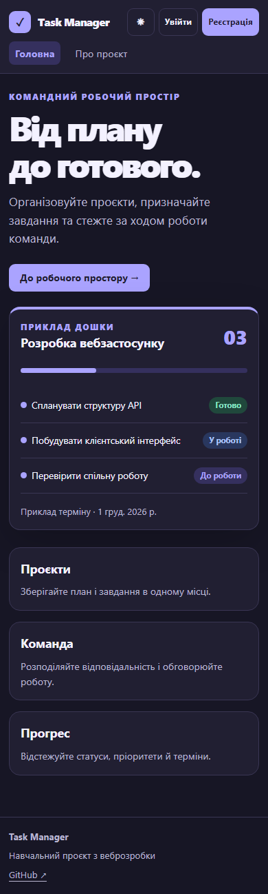
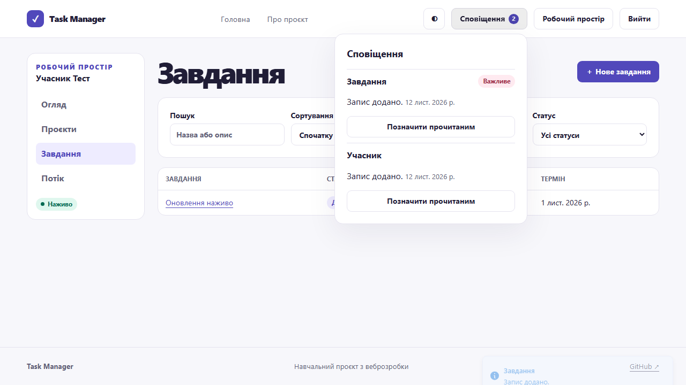
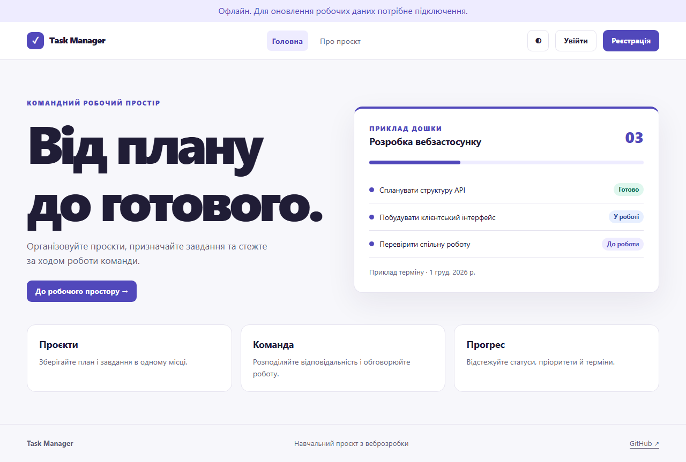
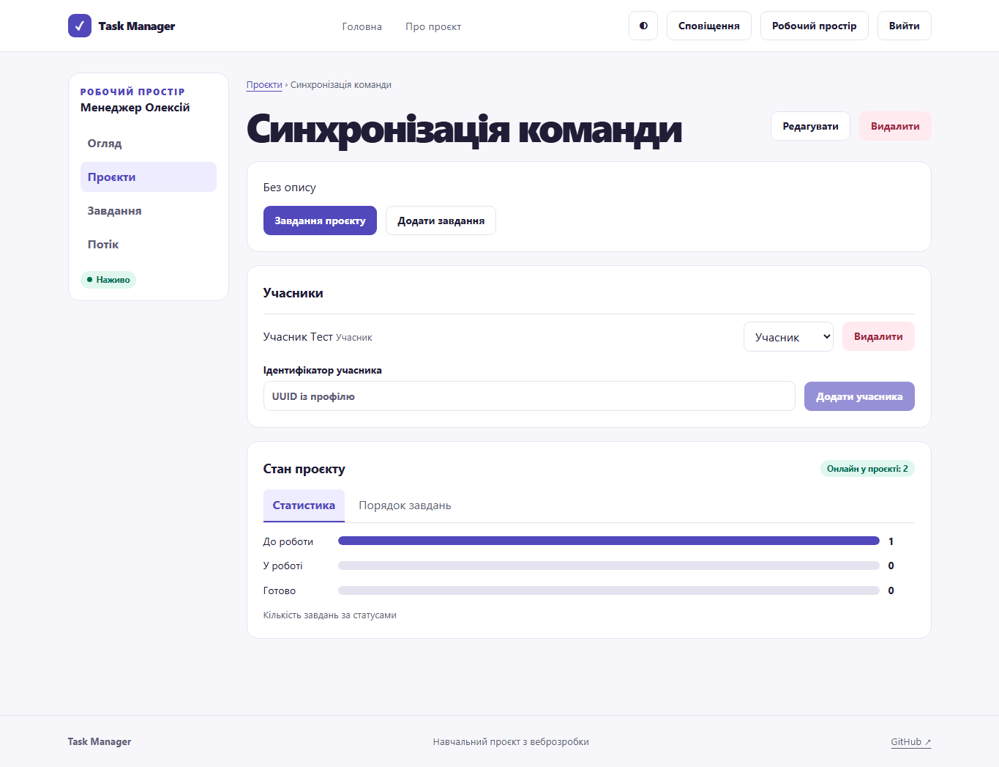
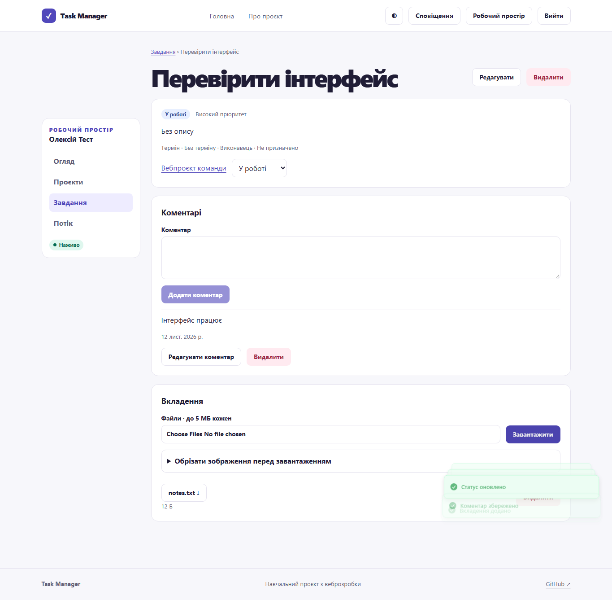
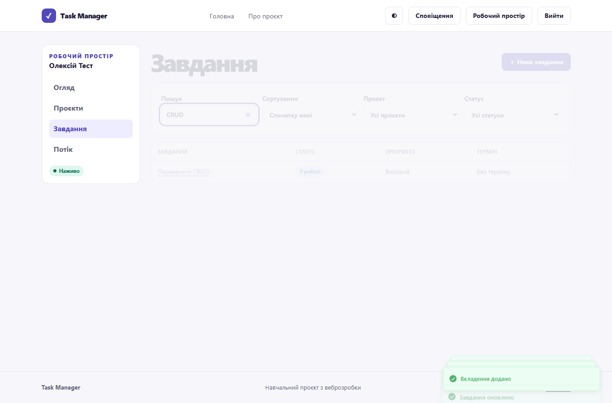

# Звіт з лабораторної роботи 6

## Тема роботи

Розширені можливості та розгортання клієнтської частини

Здобувач освіти: **Синюк Олексій**  
Група: **ІПЗ-41**  
GitHub репозиторій: [olecsix/weblabs](https://github.com/olecsix/weblabs/tree/main)

[Умова роботи](https://github.com/olroi421/course-web/blob/main/labs/lab-06.md) · [Запуск і документація](../README.md)

## Мета

Інтегрувати клієнт із Socket.IO і підготувати збірку до публікації.

## Реалізований функціонал

Сповіщення, присутність, оновлення списків, діалоги, таби, пошукове меню, DnD, статистика, нескінченний список, crop, календар, форматування та анімації. PWA, lazy-маршрути, SEO, Vercel і CI.

## Ключові фрагменти коду

`src/components/Live.tsx` підписується на події та оновлює кеш. `ProjectTools.tsx` показує статистику й змінює порядок. `Editors.tsx` реалізує календар, форматування й crop. `vite.config.ts` створює Service Worker.

## Перевірка

Пройшли чотири браузерні перевірки виробничої збірки. Дві окремі сесії синхронізували завдання і сповіщення, а офлайн-тест перезавантажив кешовану оболонку. Vercel підготовлено, публічний сайт ще не підключено.

## Скріншоти

## Контрольні запитання

1. WebSocket підтримує двосторонні події через постійне з’єднання. HTTP потрібний для CRUD та отримання актуального знімка після reconnect.
2. Один екземпляр Socket.IO підключається при вході, оновлює auth при ротації й закривається при виході. Cleanup видаляє власний callback.
3. Portal рендерить діалог у document.body. Native dialog забезпечує модальний фокус і Escape, а aria-labelledby та aria-describedby зв’язують підписи.
4. dnd-kit дає сенсори для миші, дотику і клавіатури. KeyboardSensor та координати sortable підтримують пробіл і стрілки. HTML Drag and Drop потребує окремих механізмів доступності.
5. React.lazy використовує динамічний import. Suspense показує стан очікування, а Vite формує окремі чанки.
6. Service Worker може перехопити запит. CacheFirst підходить для версійованих ресурсів, NetworkFirst — для актуальних даних, StaleWhileRevalidate — для швидкої видачі з фоновим оновленням.
7. LCP оцінює видимість головного контенту, INP — реакцію на дії, CLS — стабільність макета. Їх вимірюють Lighthouse та польові Web Vitals.
8. Vercel і Netlify збирають SPA з Git. Rewrite віддає index.html для клієнтських маршрутів. Змінні VITE_* потрапляють у JS під час збірки.
9. CI запускає лінтинг, тести й збірку для кожної зміни. CD публікує перевірений стан main, якщо налаштовані доступи.
10. Title, description та Open Graph описують публічну сторінку. SSR або SSG потрібні для окремих URL із контентом, який має бути доступний пошуковику до виконання JS.

## Висновки

Пройшли чотири браузерні перевірки виробничої збірки.
